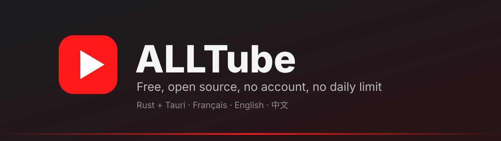

<div align="center">



**Français** · [English](README.md) · [Page de téléchargement](https://madjeek-web.github.io/alltube/) · [Guide utilisateur](docs/guide-utilisateur.md) · [Versions](https://github.com/madjeek-web/alltube/releases)

[](https://github.com/madjeek-web/alltube/actions/workflows/ci.yml)


</div>

Un logiciel gratuit qui télécharge des vidéos et de la musique depuis le web. Tu l'installes, tu colles un lien, tu choisis un format, tu cliques sur OK. Pas de compte. Pas de limite par jour. Aucun pistage. Open source.


## ALLTube : ce que c'est vraiment, expliqué simplement

### L'image du monde physique

Pense à une boutique de photocopies. Tu apportes un document, tu choisis le papier et la qualité, et un employé fait la copie et la dépose dans ton dossier.

ALLTube, c'est le comptoir de cette boutique. Tu lui donnes un lien. Tu choisis le format : une vidéo en HD, ou seulement le son en MP3. Derrière le comptoir, deux outils gratuits très connus font le vrai travail : **yt-dlp** trouve et récupère le fichier, et **FFmpeg** le convertit. ALLTube leur donne les bons ordres, t'affiche l'avancement, et range le résultat dans ton dossier.

### En une phrase

C'est un petit programme que tu installes sur ton ordinateur : tu colles un lien, tu choisis un format, et le fichier arrive dans `Téléchargements/ALLTube`. Rien à créer, rien à payer, rien d'envoyé nulle part.


## Ce qu'il sait faire

**Télécharger**

Colle un lien (ou tape des mots-clés) et appuie sur OK. Fais `CTRL + V` n'importe où dans la fenêtre et un lien est téléchargé tout de suite. Jusqu'à 8 téléchargements en même temps, et **aucune limite par jour** : il n'y a ni compteur, ni compte, ni serveur dans ALLTube.

**14 formats**

| Vidéo | Audio |
|---|---|
| MP4 SD (480p) | MP3 LQ (128 kbps) |
| MP4 HD (720p) | MP3 MQ (192 kbps) |
| MP4 FHD (1080p) | MP3 HQ (320 kbps) |
| MP4 2K (1440p) | M4A |
| 3GP | OGG |
| FLV | FLAC |
| Codecs personnalisés (MP4, MKV, WebM avec H.264, H.265, VP9, AV1 et AAC, MP3, Opus) | WAV |

**Découper une vidéo** (l'icône ciseaux)

Ouvre ou dépose une vidéo ou un fichier audio, choisis le début et la fin, puis découpe. Le *mode rapide* copie sans recompresser (instantané, peut varier de quelques secondes). Le *mode précis* recompresse pour couper à l'image près.

**Paramètres**

Dossier des téléchargements, sous-titres (avec les langues de ton choix), autres pistes audio, notification de fin, nombre de téléchargements simultanés, délai entre les téléchargements, langue de l'interface, thème sombre ou clair, et cookies du navigateur (pour accéder à des vidéos privées que tu as le droit de voir).

**Trois langues**

Français (par défaut), anglais et chinois (mandarin). Change-la dans **Paramètres > Langue**.


## Comment on l'utilise concrètement

- **Un élève** garde un cours enregistré par son professeur (avec son accord) pour le regarder hors connexion dans le train.
- **Un créateur** télécharge ses propres vidéos depuis une plateforme pour les remonter, en meilleure qualité.
- **Un musicien** extrait le son d'un morceau sous licence libre en FLAC ou en MP3 pour un projet.
- **Un enseignant** enregistre un documentaire sous licence Creative Commons pour une classe sans Internet.
- **Un voyageur** prépare une playlist pour un vol, puis découpe le meilleur passage d'une longue vidéo avec les ciseaux.
- **Un archiviste** garde une copie de vidéos du domaine public avant qu'elles ne disparaissent.


## Pourquoi c'est sérieux techniquement

- **Rust** pour le cerveau (réglages, file d'attente, sécurité) et **Tauri 2** pour la fenêtre, qui utilise le moteur web déjà présent dans Windows : léger et rapide.
- **20 tests automatiques** sur les recettes de formats, la validation des réglages et la vérification des liens, plus clippy sans aucun avertissement, lancés par un robot à chaque modification.
- **CodeQL**, **Dependabot** et un **cargo audit** hebdomadaire surveillent le code et les bibliothèques. Les actions GitHub sont épinglées par empreinte de commit.
- Chaque ligne du code source est **commentée avec des mots simples** : un débutant peut la lire comme un cours. Commence par [docs/architecture.md](docs/architecture.md).


## Ce que ce projet n'est pas

- Il **ne contourne pas** les protections anti-copie (DRM). Il télécharge ce que ton navigateur pourrait lire.
- Il n'a **pas de compte**, **pas de télémétrie**, **pas de publicité** et **pas de serveur**. ALLTube n'envoie rien nulle part.
- Il n'est **affilié à aucun site**. YouTube, TikTok, X et les autres noms appartiennent à leurs propriétaires et servent seulement à dire quels types de liens fonctionnent.
- Ce n'est pas un moyen d'obtenir ce que tu n'as pas le droit d'avoir.


## ALLTube et la loi : ce qu'il faut savoir

**En une phrase :** ALLTube est un outil neutre, et **tu es responsable de ce que tu télécharges**.

- La plupart des vidéos et des chansons sont protégées par le **droit d'auteur**. Les télécharger sans autorisation est illégal dans beaucoup de pays, même pour un usage personnel.
- La plupart des sites interdisent le téléchargement dans leurs **conditions d'utilisation**. Les enfreindre peut entraîner la fermeture de ton compte.
- Certains contenus se téléchargent sans problème : tes propres vidéos, les contenus sous licence **Creative Commons** ou du **domaine public**, ceux dont l'auteur donne son accord, et ce que tu as le droit de copier pour un usage privé quand la loi de ton pays le permet.
- Les règles changent d'un pays à l'autre. Dans le doute, demande l'autorisation ou ne télécharge pas.

ALLTube est comme un couteau de cuisine : bien utilisé il sert à tout le monde, mal utilisé il crée des problèmes. L'outil est transparent et open source : tu peux lire exactement ce qu'il fait. L'utiliser légalement, c'est à toi de le faire.


## Démarrage rapide

### Windows 11 (testé)

1. Ouvre la [page de téléchargement](https://madjeek-web.github.io/alltube/) ou la page [Versions](https://github.com/madjeek-web/alltube/releases/latest) et télécharge `ALLTube_1.0.0_x64-setup.exe`.
2. Double-clique sur le fichier. Si Windows affiche *« Windows a protégé votre ordinateur »*, clique sur **Informations complémentaires**, puis **Exécuter quand même** (voir [Sécurité](#sécurité) pour comprendre pourquoi, et comment vérifier le fichier).
3. Suis l'installateur. Il s'installe pour ton utilisateur seulement et n'a pas besoin des droits administrateur.
4. Ouvre **ALLTube** depuis le menu Démarrer ou le raccourci du Bureau.

### macOS et Linux

Pas encore publiés : le code est prêt, mais les installateurs doivent encore être fabriqués et testés sur de vraies machines. Voir la [feuille de route](ROADMAP.md). Les développeurs peuvent déjà compiler depuis les sources sous Linux.

### Où sont mes fichiers ?

Tout ce que tu télécharges va ici :

```
Ce PC  >  Téléchargements  >  ALLTube
```

Sous Windows : ouvre l'**Explorateur de fichiers** (le dossier jaune de la barre des tâches), clique sur **Téléchargements** à gauche, puis ouvre le dossier **ALLTube**. Tu peux changer ce dossier dans **Paramètres > Dossier des téléchargements**. Guide complet pas à pas : [docs/guide-utilisateur.md](docs/guide-utilisateur.md).


## Sécurité

ALLTube est conçu pour être sûr dès sa conception :

- **Aucun shell.** Les moteurs sont lancés directement avec une liste d'arguments. Un lien piégé ne peut pas exécuter de commande.
- Les liens sont validés (`http` et `https` uniquement) et toujours passés après `--` : ils ne peuvent jamais être pris pour une option.
- La page web envoie seulement des identifiants comme `mp4_fhd`. Le code Rust construit les vraies commandes et **revérifie chaque réglage**.
- La page ne peut pas ouvrir un fichier au hasard : elle envoie seulement un numéro de téléchargement. Seules les extensions de médias peuvent être ouvertes (jamais `.exe`).
- Les moteurs sont cherchés **uniquement à côté du programme**, jamais dans le `PATH` du système.
- Politique de sécurité (CSP) stricte, aucun script inline, permissions Tauri minimales. Les titres venus d'Internet sont affichés comme du texte simple.
- Les moteurs (yt-dlp, FFmpeg) viennent de leurs dépôts officiels et sont **vérifiés par SHA-256** avant utilisation.

Signaler un problème en privé : [SECURITY.md](SECURITY.md).

### Vérifier ton téléchargement

Chaque version contient un fichier `SHA256SUMS.txt`. Dans PowerShell, dans ton dossier Téléchargements :

```powershell
Get-FileHash .\ALLTube_1.0.0_x64-setup.exe -Algorithm SHA256
```

Le résultat doit correspondre au fichier. Sinon, ne l'installe pas.

### Antivirus et SmartScreen

Personne ne peut promettre qu'aucun antivirus ne réagira jamais : même de gros logiciels subissent des « faux positifs ». Ce que fait ALLTube pour les éviter : pas de packer, pas d'obfuscation, aucun exécutable téléchargé au premier lancement, moteurs officiels vérifiés par empreinte, installation sans droits administrateur, code source ouvert. L'installateur **n'est pas encore signé numériquement** (c'est dans la [feuille de route](ROADMAP.md)), donc SmartScreen de Windows peut afficher un avertissement. Si un antivirus le bloque, ouvre un ticket et signale le fichier à l'éditeur comme faux positif.


## Problèmes connus dans la 1.0.0

- Une **erreur rouge** peut s'afficher alors que le fichier est bien enregistré dans `Téléchargements/ALLTube`. Regarde dans le dossier : le fichier y est en général. Nous cherchons la cause ; copie le message rouge complet dans un ticket.
- Pas d'aperçu vidéo dans l'outil de découpe.
- Windows uniquement pour l'instant.

La liste complète des changements est dans le [CHANGELOG](CHANGELOG.md).


## Compiler depuis les sources

Il te faut **Windows 11**, [Visual Studio Build Tools](https://visualstudio.microsoft.com/visual-cpp-build-tools/) (charge de travail *Développement Desktop en C++*) et [Rust](https://rustup.rs). Ensuite, dans un terminal à la racine du projet :

```powershell
cargo install tauri-cli --version "^2" --locked
powershell -ExecutionPolicy Bypass -File scripts\fetch-sidecars.ps1
cargo tauri dev                       # lancer en mode test
cargo tauri build --bundles nsis      # fabriquer l'installateur
```

L'installateur apparaît dans `src-tauri\target\release\bundle\nsis\`.

### Lancer les tests

```bash
node scripts/check-i18n.js            # traductions complètes ?
cd src-tauri
cargo test                            # 20 tests automatiques
cargo clippy --all-targets -- -D warnings
```

### Mettre tes propres icônes

- **Icônes de l'interface** : remplace les fichiers de `src/assets/icons/` (mêmes noms).
- **Icônes de l'application** (raccourci Bureau, barre des tâches) : place un PNG transparent de 1024 x 1024 dans `src-tauri/icons/source.png`, puis lance `cargo tauri icon src-tauri/icons/source.png`.


## Structure du projet

La structure complète (avec le rôle de chaque fichier) est dans le [README en anglais](README.md#project-structure). En résumé :

- `src/` : **le visage** (HTML, CSS, JavaScript). `src/js/i18n.js` contient tous les textes en 3 langues.
- `src-tauri/src/` : **le cerveau** (Rust) : `main.rs`, `settings.rs`, `formats.rs`, `input.rs`, `engine.rs`, `downloads.rs`, `media.rs`.
- `scripts/` : récupération des moteurs, empreintes, contrôle des traductions.
- `site/` : la page de téléchargement (GitHub Pages).
- `docs/` : l'architecture expliquée simplement et les guides utilisateur.
- `.github/` : robots de vérification, modèles de tickets, mises à jour automatiques.


## Contribuer

Tu peux **forker** le projet, l'améliorer et proposer tes changements. La version 1.0.0 reste en ligne pour toujours, à côté des suivantes. Tout est expliqué avec des mots simples dans [CONTRIBUTING.md](CONTRIBUTING.md), et les contributeurs sont listés sur cette page et dans [CONTRIBUTORS.md](CONTRIBUTORS.md). Les idées pour les prochaines versions sont dans la [feuille de route](ROADMAP.md).

## Licence

Licence MIT - 23 / 11 / 2026 - Fabien Conéjéro. Voir [LICENSE](LICENSE). Outils tiers : [THIRD_PARTY.md](THIRD_PARTY.md).

Auteur : <https://github.com/madjeek-web>

Page de téléchargement : <https://madjeek-web.github.io/alltube/>

Merci pour votre soutien.
