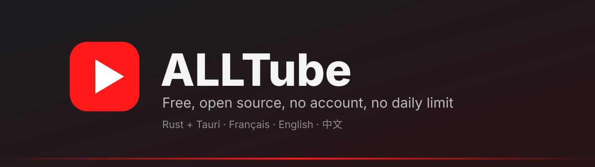

<div align="center">



[Français](README.fr.md) · **English** · [Download page](https://madjeek-web.github.io/alltube/) · [User guide](docs/user-guide.md) · [Releases](https://github.com/madjeek-web/alltube/releases)

[](https://github.com/madjeek-web/alltube/actions/workflows/ci.yml)


</div>

A free desktop app that downloads videos and music from the web. Install it, paste a link, pick a format, click OK. No account. No daily limit. No tracking. Open source.


## ALLTube: what it really is, explained simply

### The image of the physical world

Think of a copy shop. You bring a document, you choose the paper and the quality, and a clerk makes the copy and puts it in your folder.

ALLTube is the counter of that shop. You give it a link. You choose the format: a video in HD, or only the sound as an MP3. Behind the counter, two very well known free tools do the real work: **yt-dlp** finds and fetches the file, and **FFmpeg** converts it. ALLTube gives them the right orders, shows you the progress, and puts the result in your folder.

### In one sentence

It is a small program you install on your computer: you paste a link, you choose a format, and the file lands in `Downloads/ALLTube`. Nothing to create, nothing to pay, nothing sent anywhere.


## What it does

**Download**

Paste a link (or type keywords) and press OK. Press `CTRL + V` anywhere in the window and a link is downloaded right away. Up to 8 downloads at the same time, and **no daily limit**: there is no counter, no account and no server in ALLTube.

**14 formats**

| Video | Audio |
|---|---|
| MP4 SD (480p) | MP3 LQ (128 kbps) |
| MP4 HD (720p) | MP3 MQ (192 kbps) |
| MP4 FHD (1080p) | MP3 HQ (320 kbps) |
| MP4 2K (1440p) | M4A |
| 3GP | OGG |
| FLV | FLAC |
| Custom codecs (MP4, MKV, WebM with H.264, H.265, VP9, AV1 and AAC, MP3, Opus) | WAV |

**Cut a video** (the scissors icon)

Open or drop a video or an audio file, choose the start and the end, and cut. *Fast mode* copies without re-encoding (instant, may be off by a few seconds). *Precise mode* re-encodes to cut to the exact frame.

**Settings**

Download folder, subtitles (with the languages you choose), other audio tracks, completion notification, number of simultaneous downloads, delay between downloads, interface language, dark or light theme, and browser cookies (to reach private videos you are allowed to see).

**Three languages**

French (default), English and Chinese (Mandarin). Switch in **Settings > Language**.


## How people use it concretely

- **A student** keeps a lecture recorded by their teacher (with permission) to watch it offline on the train.
- **A creator** downloads their own videos from a platform to edit them again, in the best quality.
- **A musician** extracts the audio of a free-licensed track as a FLAC or MP3 for a project.
- **A teacher** saves a Creative Commons documentary for a class without Internet.
- **A traveler** prepares a playlist for a flight, then cuts the best part of a long video with the scissors.
- **An archivist** keeps a copy of public domain videos before they disappear.


## Why it is technically serious

- **Rust** for the brain (settings, queue, security) and **Tauri 2** for the window, which uses the web engine already inside Windows: small and fast.
- **20 automatic tests** on the format recipes, the settings validation and the link checker, plus clippy with zero warnings, run by a robot on every change.
- **CodeQL**, **Dependabot** and a weekly **cargo audit** watch the code and the libraries. GitHub Actions are pinned by commit hash.
- Every line of source code is **commented in simple words**, so a beginner can read it like a course. Start with [docs/architecture.md](docs/architecture.md).


## What this project is not

- It does **not** break copy protection (DRM). It downloads what your browser could play.
- It has **no account**, **no telemetry**, **no advertising** and **no server**. Nothing is sent anywhere by ALLTube.
- It is **not affiliated with** any website. YouTube, TikTok, X and other names belong to their owners and are only used to say which kinds of links work.
- It is not a way to get things you are not allowed to have.


## ALLTube and the law: what you need to know

**In one sentence:** ALLTube is a neutral tool, and **you are responsible for what you download**.

- Most videos and songs are protected by **copyright**. Downloading them without permission is illegal in many countries, even for personal use.
- Most websites forbid downloading in their **terms of service**. Breaking them can get your account closed.
- Some content is perfectly fine to download: your own videos, content with a **Creative Commons** or **public domain** license, content whose author allows it, and things you have the right to copy for private use where your country's law allows it.
- Rules differ from one country to another. When in doubt, ask for permission or do not download.

ALLTube is like a kitchen knife: used properly it is useful to everyone, used badly it creates problems. The tool is transparent and open source: you can read exactly what it does. Using it legally is up to you.


## Quick start

### Windows 11 (tested)

1. Open the [download page](https://madjeek-web.github.io/alltube/) or the [Releases](https://github.com/madjeek-web/alltube/releases/latest) page and download `ALLTube_1.0.0_x64-setup.exe`.
2. Double-click the file. If Windows shows *"Windows protected your PC"*, click **More info**, then **Run anyway** (see [Security](#security) for why, and how to check the file).
3. Follow the installer. It installs for your user only and does not need administrator rights.
4. Open **ALLTube** from the Start menu or the desktop shortcut.

### macOS and Linux

Not published yet: the code is ready for them, but installers still have to be built and tested on real machines. See the [roadmap](ROADMAP.md). Developers can already build from source on Linux.

### Where are my files?

Everything you download goes here:

```
This PC  >  Downloads  >  ALLTube
```

In Windows: open **File Explorer** (the yellow folder in the taskbar), click **Downloads** on the left, then open the **ALLTube** folder. You can change this folder in **Settings > Downloads folder**. Full step-by-step guide: [docs/user-guide.md](docs/user-guide.md).


## Security

ALLTube is built to be safe by design:

- **No shell.** The engines are started directly with a list of arguments. A malicious link cannot run a command.
- Links are validated (`http` and `https` only) and always passed after `--`, so they can never be read as an option.
- The web page only sends identifiers like `mp4_fhd`. The Rust code builds the real commands and **re-checks every setting**.
- The page cannot open an arbitrary file: it only sends a download number. Only media extensions can be opened (never `.exe`).
- Engines are only looked up **next to the program**, never in the system `PATH`.
- Strict Content Security Policy, no inline script, minimal Tauri permissions. Titles from the Internet are displayed as plain text.
- The engines (yt-dlp, FFmpeg) come from their official repositories and are **verified by SHA-256** before use.

Report a problem privately: [SECURITY.md](SECURITY.md).

### Verify your download

Every release has a `SHA256SUMS.txt`. In PowerShell, in your Downloads folder:

```powershell
Get-FileHash .\ALLTube_1.0.0_x64-setup.exe -Algorithm SHA256
```

The result must match the file. If not, do not install it.

### Antivirus and SmartScreen

Nobody can promise that no antivirus will ever complain: even big programs get "false positives". What ALLTube does to avoid them: no packer, no obfuscation, no executable downloaded at first launch, official engines checked by hash, installation without administrator rights, open source code. The installer is **not code-signed yet** (it is on the [roadmap](ROADMAP.md)), so Windows SmartScreen may warn you. If an antivirus blocks it, open an issue and report the file to the vendor as a false positive.


## Known issues in 1.0.0

- A **red error** can appear even though the file was saved correctly in `Downloads/ALLTube`. Check the folder: the file is usually there. We are investigating; please copy the full red message in a bug report.
- No video preview in the cutting tool.
- Windows only for now.

The full list of changes is in the [CHANGELOG](CHANGELOG.md).


## Build from source

You need **Windows 11**, [Visual Studio Build Tools](https://visualstudio.microsoft.com/visual-cpp-build-tools/) (workload *Desktop development with C++*) and [Rust](https://rustup.rs). Then, in a terminal at the root of the project:

```powershell
cargo install tauri-cli --version "^2" --locked
powershell -ExecutionPolicy Bypass -File scripts\fetch-sidecars.ps1
cargo tauri dev                       # run it in test mode
cargo tauri build --bundles nsis      # build the installer
```

The installer appears in `src-tauri\target\release\bundle\nsis\`.

### Run the tests

```bash
node scripts/check-i18n.js            # translations complete?
cd src-tauri
cargo test                            # 20 automatic tests
cargo clippy --all-targets -- -D warnings
```

### Use your own icons

- **Interface icons**: replace the files in `src/assets/icons/` (same names).
- **App icons** (desktop shortcut, taskbar): put a 1024x1024 transparent PNG at `src-tauri/icons/source.png`, then run `cargo tauri icon src-tauri/icons/source.png`.


## Project structure

```
alltube/
├── .github/
│   ├── workflows/
│   │   ├── ci.yml                 Checks on every change (tests, clippy, translations)
│   │   ├── codeql.yml             Automatic security analysis
│   │   ├── audit.yml              Known vulnerabilities in Rust libraries
│   │   ├── pages.yml              Publishes the download page
│   │   └── release.yml            Builds installers (manual, experimental)
│   ├── ISSUE_TEMPLATE/            Forms for bug reports and ideas
│   ├── PULL_REQUEST_TEMPLATE.md
│   ├── CODEOWNERS
│   └── dependabot.yml
├── docs/
│   ├── architecture.md            How the project works (read this first!)
│   ├── user-guide.md              Install and use, step by step (English)
│   ├── guide-utilisateur.md       Même guide en français
│   └── assets/                    Cover and logo for the README
├── scripts/
│   ├── fetch-sidecars.ps1         Gets yt-dlp + ffmpeg on Windows (checked by SHA-256)
│   ├── fetch-sidecars.sh          Same for Linux
│   ├── make-checksums.ps1         Creates SHA256SUMS.txt for a release
│   └── check-i18n.js              Checks the translations
├── site/
│   └── index.html                 The download page (GitHub Pages)
├── src/                           The face: HTML, CSS, JavaScript
│   ├── index.html
│   ├── css/style.css
│   ├── js/i18n.js                 Texts in French, English, Chinese
│   ├── js/app.js                  Behavior of the window
│   └── assets/icons/              Interface icons (replaceable)
├── src-tauri/                     The brain: Rust
│   ├── src/main.rs                Start-up + commands the page may call
│   ├── src/settings.rs            Settings, checked and saved safely
│   ├── src/formats.rs             The 14 formats and their recipes
│   ├── src/input.rs               Checks the link or keywords typed
│   ├── src/engine.rs              Starts yt-dlp / ffmpeg safely
│   ├── src/downloads.rs           The download queue
│   ├── src/media.rs               ffmpeg: conversion and cutting
│   ├── icons/                     App icons (desktop, taskbar, installer)
│   ├── binaries/                  Engines (filled by the scripts, not in Git)
│   ├── capabilities/default.json  Minimal permissions
│   ├── tauri.conf.json            Window, security policy, installer
│   └── Cargo.toml
├── CHANGELOG.md
├── CODE_OF_CONDUCT.md
├── CONTRIBUTING.md
├── CONTRIBUTORS.md
├── LICENSE
├── README.md  /  README.fr.md
├── ROADMAP.md
├── SECURITY.md
└── THIRD_PARTY.md                 yt-dlp, FFmpeg and Tauri licenses
```


## Contributing

You can **fork** the project, improve it and propose your changes. Version 1.0.0 stays online forever next to the next ones. Everything is explained with simple words in [CONTRIBUTING.md](CONTRIBUTING.md), and contributors are listed on this page and in [CONTRIBUTORS.md](CONTRIBUTORS.md). The ideas for the next versions are in the [ROADMAP](ROADMAP.md).

## License

MIT License - 23 / 11 / 2026 - Fabien Conéjéro. See [LICENSE](LICENSE). Third-party tools: [THIRD_PARTY.md](THIRD_PARTY.md).

Author: <https://github.com/madjeek-web>

Download page: <https://madjeek-web.github.io/alltube/>

Thank you for your support.
